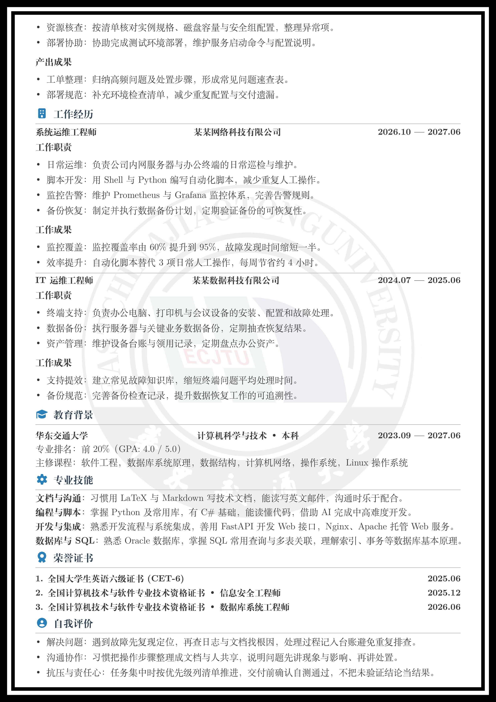

<div align="center">

<h1 align="center">
  
</h1>

把简历当代码写：内容归内容，排版归排版，版面效果跨平台强一致性。

[](https://github.com/tellcts/resumes-CV/actions/workflows/build-check.yml)

[](src/templates/tzcan/USAGE.md#方式一overleaf-在线编译)
[](src/templates/tzcan/USAGE.md#方式三docker-容器编译)
[](https://github.com/tellcts/resumes-CV/releases)
[](https://github.com/tellcts/resumes-CV)
[](LICENSE)


</div>

---

## 🖼️ 效果预览

<div align="center">




**tzcan 模板** · 第 1 / 2 页 —— 双矩形边框 · 校徽水印 · 内容与版式彻底分离

[🖼️ **查看全部模板效果图 →**](PREVIEWS.md) · [📖 **tzcan 使用说明**](src/templates/tzcan/USAGE.md)

</div>

## 📖 这是什么

**resumes-CV** 是一个用 LaTeX 编写的**模块化简历模板库**。

你唯一需要编辑的文件是 `main.tex` —— 在里面填姓名、电话、项目经历这些**内容**；
字号、纸张、页边距、配色、边框这些**版式**全部由文档类 `styles/resume-tzcan.cls` 和
`styles/components/` 下的组件提供。所有组件都走**键值对接口**，不需要你会写 LaTeX 宏包：

```latex
\cvproject{
  name  = {制造产线品质数据可视化分析},
  date  = {2026.06 --- 2026.08},
  tech  = {Python~\midbullet~Pandas~\midbullet~SQLite},
  duty  = {
  \item 数据建模与统计： 设计 SQLite 表结构，定义插损/回损判定阈值。
  },
}
```

填完执行 `latexmk main.tex`，得到 `build/main.pdf`。就这样。

每个模板都配有完整的中文使用说明，从装环境一路讲到**每个组件的每个字段是否可选** ——
见下方 [可用模板](#-可用模板)。

## ✨ 相比之下有什么优势

### 一张表看懂

|                | 简历制作网站             | Word / 在线模板          | **本模板（LaTeX）**            |
| -------------- | ------------------------ | ------------------------ | ------------------------------ |
| **排版精确度** | ❌ 模板写死，改不动       | ⚠️ 拖拽易跑位，换设备错版 | ✅ 代码控制，结果**可复现**     |
| **内容与版式** | ❌ 混在一起               | ❌ 混在一起               | ✅ **彻底分离**                 |
| **版本管理**   | ❌ 无历史，改错回不去     | ⚠️ 靠另存为堆文件名       | ✅ Git 友好，纯文本可 diff      |
| **隐私**       | ❌ 简历上传到第三方服务器 | ⚠️ 本地，但可能带云同步   | ✅ **全本地，数据不出机器**     |
| **多版本投递** | ⚠️ 手动改一遍             | ⚠️ 手动改一遍             | ✅ 复制目录 / 按需增删模块      |
| **格式规范**   | ⚠️ 看模板作者心情         | ⚠️ 靠手动对齐             | ✅ 统一组件，全篇风格一致       |
| **学习成本**   | ✅ 最低                   | ✅ 低                     | ⚠️ 中（已封装成键值对降低门槛） |
| **费用**       | ❌ 导出 PDF 常要会员      | ⚠️ 部分模板收费           | ✅ **非商业用途免费**           |

### 🔒 数据不出本地

简历上有你的真实姓名、手机号、住址、学历、工作经历 —— 这些是**高度敏感的个人信息**。

用网站做简历意味着把这些**主动上传到别人的服务器**，还要担心它会不会被用来做用户画像、
会不会在某次数据泄露里被拖走。本模板全程在你自己电脑上编译，**不联网、不上传、不注册**。

> [!NOTE]
> 唯一的例外是 [🔧 环境要求](#-环境要求) 里的 **Overleaf 在线编译** —— 它零安装、最快上手，
> 代价就是简历存到 Overleaf 的云端。在意隐私就选 Docker 或本地安装，三条路编出来的 PDF 一样。

### 🧩 内容与版式彻底分离

`main.tex` 里**只有内容和键值对，一行版式代码都没有**。带来的直接好处：

- **改内容不会塌版**：加一段项目经历、删一条技能，其余部分纹丝不动。
- **改版式不用碰内容**：想换配色、调页边距，改 `.sty` 文件里的一个变量即可全局生效。
- **不用懂 LaTeX**：所有组件都是 `键 = {值}` 的形式，会填空就会用。

### 📦 模块化，按需取用

`\cvsection` / `\cvproject` / `\cvskillcategory` / `\cvhonor` …… 十几个组件彼此独立，
**想用哪个用哪个，不用的直接删**。不需要的模块删掉后不会留下空行或多余的分隔符
（分隔符只出现在两个确有内容的条目之间）。

### 🎯 排版精确且可复现

在线模板调间距靠「拖动 + 肉眼瞅」，本模板靠**数值**：

- 分割线右端自动对齐证件照右边界，换照片宽度也**自动重算**；
- 圆点列表缩进、标题间距、边框粗细都是可调变量，改一处全局生效；
- 同一份源码在任何机器上编译，**输出完全一致** —— 今天投的和下周投的是同一个版式。

## 🎨 可用模板

| 模板                          | 风格                                                                  | 使用说明                                       | 效果预览                                |
| ----------------------------- | --------------------------------------------------------------------- | ---------------------------------------------- | --------------------------------------- |
| **tzcan** <br/>*(目前已实现)* | 双矩形边框 · 校徽水印 · 两行信息栏 · 内容/版式分离 · 全组件键值对接口 | [📖 **USAGE.md**](src/templates/tzcan/USAGE.md) | [🖼️ **第 1 ~ 2 页**](PREVIEWS.md#-tzcan) |

> [!NOTE]
> 更多模板开发中，欢迎[参与贡献](#-参与贡献)。
>
> **全部模板的效果图都在 [🖼️ PREVIEWS.md](PREVIEWS.md)** —— 本 README 的预览区只展示 tzcan 一个模板，
> 免得越堆越长。图片源文件放在 `previews/template-<模板名>/` 下，
> 新增模板时的具体要求见 [🤝 CONTRIBUTING.md](CONTRIBUTING.md#-新增模板规范)。

**每个模板的 `USAGE.md` 都是一份完整中文手册**，包含：

- 📦 三条编译方式（Overleaf / Docker / 本地 TeX Live）→ 📥 获取模板 → 🔨 编译全流程
- 🖼️ 证件照、校徽的替换方法与获取渠道
- 🧩 **每个组件的逐个字段说明**：键名、含义、**是否必填**、示例、排版提示
- 🎨 版式与配色定制：改哪个文件的哪个变量
- ❓ 常见问题排查

## 🚀 快速开始

先在 [🔧 环境要求](#-环境要求) 里三选一；下面这条是**本地安装 TeX Live** 的最短路径，
Overleaf / Docker 的步骤见各模板的 `USAGE.md`：

```bash
# 1. 确认环境（需 TeX Live 2026 + XeLaTeX）
xelatex --version && latexmk --version
# 尚未安装？见 https://mirrors.tuna.tsinghua.edu.cn/help/CTAN/

# 2. 克隆仓库
git clone https://github.com/tellcts/resumes-CV.git
cd resumes-CV

# 3. 进入某个模板目录（⚠️ 必须在模板目录下编译）
cd src/templates/tzcan

# 4. 编辑 main.tex 填上你的信息，然后编译
latexmk main.tex        # 产物：build/main.pdf
latexmk -pvc main.tex   # 常驻模式，保存自动重编
```

> [!WARNING]
> **必须在 `src/templates/<模板名>/` 目录下执行编译** —— `main.tex` 里的文档类是
> 相对路径，在仓库根目录编译会报找不到文档类。

## 📁 项目结构

```
resumes-CV/
├── LICENSE
├── README.md                    ← 你正在看的文件
├── CONTRIBUTING.md              # 贡献指南：开发环境 / 规范 / 提 PR 流程
├── PREVIEWS.md                  # 🖼️ 全部模板的效果图（README 只展示 tzcan）
├── previews/                    # 各模板的简历效果图（template-<模板名>/）
│   └── template-tzcan/          # tzcan-1.jpg / tzcan-2.jpg：第 1、2 页效果图
└── src/
    └── templates/
        └── tzcan/               # tzcan 模板
            ├── main.tex         # 👈 只改这一个文件：简历内容
            ├── USAGE.md         # 📖 该模板的完整使用说明
            ├── .latexmkrc       # latexmk 配置（XeLaTeX 引擎、输出到 build/）
            ├── assets/          # 证件照与校徽素材
            ├── build/           # 编译产物（main.pdf 在这里）
            └── styles/          # 版式：文档类 + 12 个组件
                ├── resume-tzcan.cls
                └── components/
                    ├── tzcan-common.sty        # 底座：主题色 / 圆点列表
                    ├── tzcan-section.sty       # \cvsection 模块标题
                    ├── tzcan-personalinfo.sty  # 个人信息区
                    ├── tzcan-project.sty       # \cvproject 项目经历
                    └── ...                     # 共 12 个组件
```

## 🔧 环境要求

**普通用户不用提前装任何东西** —— 三条路通向同一份 PDF，**任选一条即可**：
**方式一**是 **Overleaf 在线编译**；介意把简历传到网上，可选择**方式二本地安装 TeX Live**或**方式三 Docker 容器编译**。

| 方式     | 方案                  | 适合谁                       | 优点                                                 | 缺点                                                       |
| -------- | --------------------- | ---------------------------- | ---------------------------------------------------- | ---------------------------------------------------------- |
| **方式一** | **Overleaf 在线编译** | 只想尽快填内容、尽快出 PDF   | 零安装、零配置，浏览器里改完就能出 PDF，换电脑也一样 | ⚠️ 简历会上传到第三方服务器（姓名 / 电话 / 证件照都在云端） |
| **方式二** | **本地安装 TeX Live** | 在意隐私、要长期反复改简历   | 全程本地、离线可用，编译结果可复现                   | 完整版约 10 GB，装完还要配环境                             |
| **方式三** | **Docker 容器编译**   | 不想在本机装几个 GB 的 LaTeX | 免装 TeX Live，源码与产物仍留在自己电脑上            | 要先装好 Docker；首次拉镜像约 2.5 GB                       |

各条路的操作步骤（Overleaf 怎么上传、怎么切 XeLaTeX、Docker 命令行怎么写）见
[📖 tzcan `USAGE.md` → 🚀 选择编译方式](src/templates/tzcan/USAGE.md#-选择编译方式)：
[方式一：Overleaf](src/templates/tzcan/USAGE.md#方式一overleaf-在线编译) ·
[方式二：本地 TeX Live](src/templates/tzcan/USAGE.md#方式二本地安装-tex-live) ·
[方式三：Docker](src/templates/tzcan/USAGE.md#方式三docker-容器编译)。

> [!CAUTION]
> **走 Overleaf 就等于把简历交给第三方。** 姓名、手机号、邮箱、证件照都会存在它的云端 ——
> 介意的话就选另外两条，三条路编出来的 PDF 完全一样。

**Docker / 本地安装的环境要求**（Overleaf 把这些宏包全内置了，不用看这张表）：

| 项目     | 要求                                                          |
| -------- | ------------------------------------------------------------- |
| 发行版   | **TeX Live 2026**（旧版本可能缺宏包）                         |
| 引擎     | **XeLaTeX**（中文依赖 `ctex`，`pdflatex` 编译不出来）         |
| 构建工具 | **latexmk**（随 TeX Live 一起安装）                           |
| 字体     | TeX Live 自带 `Fandol`（中文）与 `Latin Modern`（西文）       |
| 宏包     | `fontawesome7` / `ctex` / `tikz` / `tabularx` / `hyperref` 等 |

本地安装请参照**清华镜像站官方指导**：<https://mirrors.tuna.tsinghua.edu.cn/help/CTAN/>；
不想在本机装 10 GB 的发行版就走 Docker（镜像拉一次，之后每次编译几秒）。装完确认两件事：

```bash
xelatex --version    # 应输出 XeTeX 3.141592653-...，TeX Live 2026
latexmk --version    # 应输出 Latexmk, John Collins, ...
```

> [!IMPORTANT]
> **本地安装时记得把 Default paper size 设为 A4**（在安装界面点 `Advanced` 才看得到）——
> 模板用 `a4paper`，不设的话部分宏包会按 Letter 排版，版式会整体跑偏。

> [!TIP]
> 若编译时提示缺宏包（如 `fontawesome7`），**不用重装 TeX Live**，缺什么补什么：
> `tlmgr install fontawesome7`

> [!NOTE]
> 模板已固定使用 TeX Live 内置的 Fandol 字体，不依赖 Windows、macOS 或 Linux 的系统字体。

## 🤝 参与贡献

欢迎提交 Issue 和 Pull Request。具体流程与要求请查看[贡献者文档](CONTRIBUTING.md)。

## 📄 许可

本项目采用 [**PolyForm Noncommercial License 1.0.0**](LICENSE)：

- ✅ **个人求职、学习、非商业项目** —— 免费使用、修改、分发
- ❌ **商业用途** —— 需另行获得授权

简历本身属于你，模板的代码属于这个项目。请保留 `LICENSE` 文件。

## ⭐ 支持这个项目

如果这个模板帮到了你 —— 比如让你在 deadline 前一晚还能安心改简历 ——
**花 3 秒点个 Star** 就是最好的回报：

<div align="center">

### [⭐ Star 一下 → github.com/tellcts/resumes-CV](https://github.com/tellcts/resumes-CV)

你的每一个 Star，都是这个项目继续维护下去的动力 💖

</div>

也欢迎把仓库分享给正在找工作的同学 👥

<div align="center">

**祝你拿到心仪的 Offer！** 🎉

</div>
