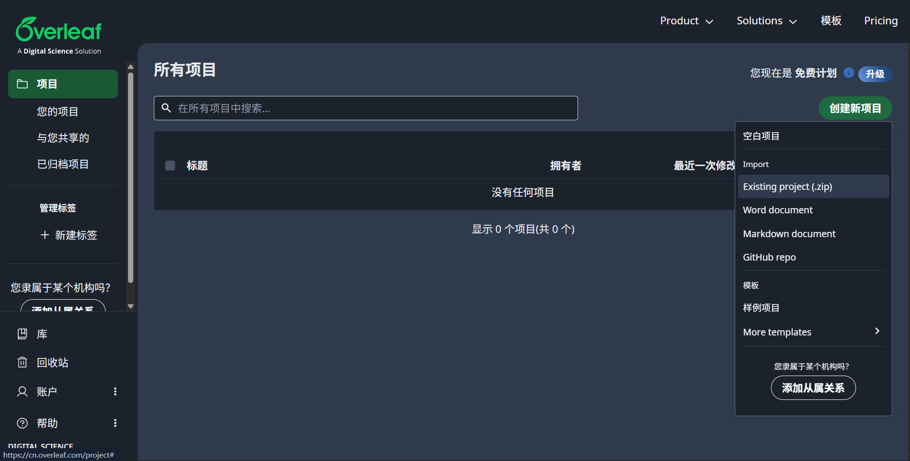
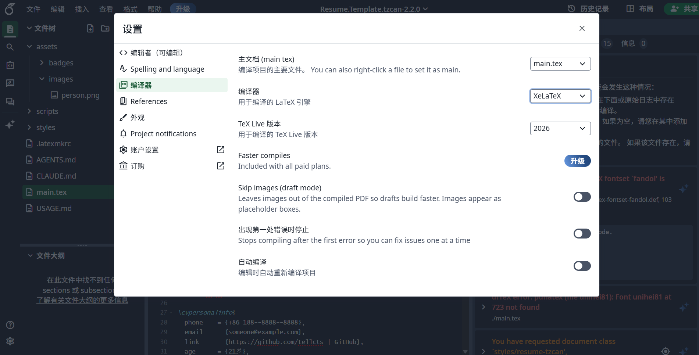
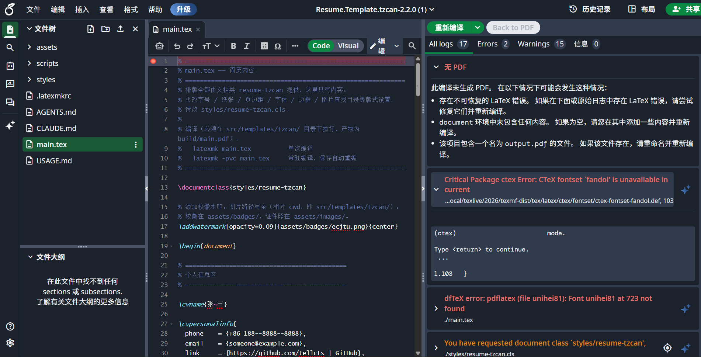
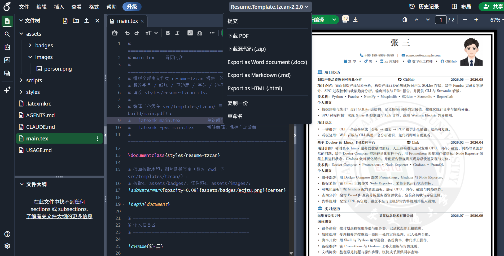

<div align="center">

# 📄 resumes-CV · tzcan 模板

</div>

## 🚀 选择编译方式

| 方式                         | 优点                             | 注意                  |
| ---------------------------- | -------------------------------- | --------------------- |
| **方式一：Overleaf（推荐）** | 零安装，浏览器内编辑和编译       | 个人资料会上传到云端  |
| **方式二：本地 TeX Live**    | 数据和产物都在本机，适合长期修改 | 需要安装完整环境      |
| **方式三：Docker**           | 不需要安装 TeX Live              | 首次拉取镜像约 2.5 GB |


### 方式一：Overleaf 在线编译

1. 选择并下载最新 Release 中的模板压缩包，如 [Resume.Template.tzcan-2.2.0.zip](https://github.com/tellcts/resumes-CV/releases/download/v2.2.0/Resume.Template.tzcan-2.2.0.zip)。
2. 登录 <https://cn.overleaf.com/>，点击`创建新项目` -> 点击`Existing project(.zip)` -> 上传模板压缩包。

3. 进入项目页面后，点击左下角表示设置的`齿轮图标` -> 点击`编译器选项` -> 切换至`XeLaTeX` -> 关闭面板。

4. 点击最右侧栏目左上角的`重新编译`选项即可。

5. 点击最上面一行居中的`压缩包名称`，选择`下载PDF`或`下载源代码`即可。推荐同时选择二者，避免修改丢失,后续重传参照前序步骤。


> [!WARNING]
> 使用 Overleaf 时，姓名、电话、邮箱和证件照都会保存在第三方服务器。介意隐私请选择本地 TeX Live 或 Docker。

### 方式二：本地安装 TeX Live

根据 [清华镜像站CTAN](https://mirrors.tuna.tsinghua.edu.cn/help/CTAN/) 本地安装好`TexLive`之后，顺序执行以下命令：

```bash
# 克隆仓库至本地
git clone --depth=1 https://github.com/tellcts/resumes-CV.git

# 进入对应模板目录
cd ./resumes-CV/src/templates/tzcan

# 在 main.tex 中修改好简历内容后编译
latexmk main.tex

# 编译常驻模式，main.tex 保存后自动编译
latexmk -pvc main.tex

# 简历 PDF 路径
./build/main.pdf
```

### 方式三：Docker 容器编译

请确保本机已经安装`Docker`，且项目已克隆至本地。
- Windows Powershell

```powershell
# 进入对应模板目录
cd ./resumes-CV/src/templates/tzcan

# 执行 Docker 编译脚本
.\scripts\docker-build.ps1

# 简历 PDF 路径
.\build\main.pdf
```
- macOS & Linux
```bash
# 进入对应模板目录
cd ./resumes-CV/src/templates/tzcan

# 执行 Docker 编译脚本
./scripts/docker-build.sh

# 简历 PDF 路径
./build/main.pdf
```

默认镜像为 `ghcr.io/tellcts/texlive:latest`。如果下载速度较慢，可将 `scripts/docker-build.ps1` 和 `scripts/docker-build.sh` 中的镜像地址替换为速度更快的兼容镜像。

首次运行会下载镜像，之后会复用镜像。编译缓存异常时，删除模板目录下的 `build/` 后重新执行脚本。

## 修改简历内容

### 命令顺序

- 下面按 `main.tex` 自上而下出现的顺序说明。每个章节都由 `\cvsection` 开始，后面接该章节的一个或多个内容条目。
- 不需要的章节，可以把对应的 `\cvsection` 和条目一起删除。
- 用户可自行调整命令调用顺序来改变模块在简历中的位置。

| 顺序 | 命令                | 用途                                 | 调用次数     |
| ---- | ------------------- | ------------------------------------ | ------------ |
| 1    | `\documentclass`    | 加载 tzcan 模板                      | 文件开头一次 |
| 2    | `\addwatermark`     | 添加校徽水印                         | 0 或 1 次    |
| 3    | `\begin{document}`  | 开始正文                             | 一次         |
| 4    | `\cvname`           | 姓名                                 | 通常一次     |
| 5    | `\cvpersonalinfo`   | 电话、邮箱、身份、求职目标等个人信息 | 通常一次     |
| 6    | `\cvphototopright`  | 右上角证件照                         | 0 或 1 次    |
| 7    | `\cvsection`        | 章节标题；每个章节开头调用           | 每个章节一次 |
| 8    | `\cvproject`        | 项目经历                             | 0 次或多次   |
| 9    | `\cvinternship`     | 实习经历                             | 0 次或多次   |
| 10   | `\cvwork`           | 工作经历                             | 0 次或多次   |
| 11   | `\cveducation`      | 教育背景                             | 0 次或多次   |
| 12   | `\cvskillcategory`  | 专业技能分类                         | 0 次或多次   |
| 13   | `\cvhonor`          | 荣誉、证书                           | 0 次或多次   |
| 14   | `\cvselfassessment` | 自我评价                             | 0 或 1 次    |
| 15   | `\end{document}`    | 结束文档并停止排版                   | 文件末尾一次 |

> [!TIP]
> **在生成的简历 PDF 中，所有链接都是可以直接点击并通过浏览器打开的。**

### `\documentclass` 加载模板

```latex
\documentclass{styles/resume-tzcan}
```

这是文档的第一条命令，必须放在 `\begin{document}` 之前，并且只能在模板目录 `src/templates/tzcan/` 下编译。
请保持 `styles/resume-tzcan` 这一模板目录内相对路径不变，否则 Overleaf、Docker 与本机编译都可能找不到文档类。

该文档类已经统一定义字号、A4 纸张、页边距、字体、边框和主题颜色，调用时不需要附加类选项。

### `\addwatermark` 校徽水印

```latex
\addwatermark[opacity=0.09]{assets/badges/ecjtu.png}{center}
```

| 参数             | 是否必填 | 说明                                                         |
| ---------------- | -------- | ------------------------------------------------------------ |
| `[...]` 可选参数 | 可选     | 传给 TikZ 节点的样式，可写 `opacity=0.09,rotate=15`          |
| 第 1 个 `{}`     | 必须     | 水印图片路径，相对于模板目录，例如 `assets/badges/ecjtu.png` |
| 第 2 个 `{}`     | 必须     | TikZ 页面锚点，例如 `center`、`north`、`south`、`north west` |

这条命令要放在 `\begin{document}` 之前。水印按页面宽度自动缩放，并绘制在每一页的背景层。
透明度建议设为 `0.03` 至 `0.15`；不需要水印时删除整行。

> [!TIP]
> **校徽图片推荐下载网站：<https://www.urongda.com/>。**
> 
> **将下载好的图片放置于`src/templates/tzcan/assets/badges/`目录下，更新`\addwatermark`命令中的文件名即可。**

| 素材     | 常用位置                   | 建议                   |
| -------- | -------------------------- | ---------------------- |
| 校徽水印 | `assets/badges/*.png`      | 透明背景 PNG，正方形   |
| 证件照   | `assets/images/person.png` | 竖版一寸照，比例约 5:7 |

### `\begin{document}` 开始正文

```latex
\begin{document}
```

这条命令把 `\documentclass` 和 `\addwatermark` 等导言区设置与简历正文分开。
姓名、个人信息和所有章节命令都必须写在 `\begin{document}` 之后。

### `\cvname` 姓名

```latex
\cvname{张~三}
```

命令只有一个必填参数，显示为大号、加粗、居中姓名。
`~` 是不换行空格，两个字的姓名可以用它增加字间距；三个字及以上的姓名通常不需要`~`。

### `\cvpersonalinfo` 个人信息栏

```latex
\cvpersonalinfo{
  phone    = {+86 188--8888--8888},
  email    = {someone@example.com},
  link     = {https://github.com/your-name | GitHub},
  age      = {21岁},
  gender   = {男},
  identity = {应届生 | 硕士在读},
  target   = {数字化工程师},
}
```

| 键         | 含义     | 是否可省略 | 写法与效果                                                  |
| ---------- | -------- | ---------- | ----------------------------------------------------------- |
| `phone`    | 电话     | 是         | 显示在第一行，并自动生成可点击的 `tel:` 链接                |
| `email`    | 邮箱     | 是         | 显示在第一行，并自动生成可点击的 `mailto:` 链接             |
| `link`     | 个人主页 | 是         | 写作 `{URL \| 显示文字}`；只写 URL 时直接显示规范化后的网址 |
| `age`      | 年龄     | 是         | 显示在第二行                                                |
| `gender`   | 性别     | 是         | 显示在第二行                                                |
| `identity` | 身份     | 是         | 显示在第二行；可用 `\|` 分隔多个身份                        |
| `target`   | 求职目标 | 是         | 显示在第二行                                                |

第一行固定显示电话和邮箱，第二行按年龄、性别、身份、求职目标、个人主页的顺序排列；
未填写的字段及其前后的分隔符会自动省略。主页链接会自动识别 GitHub、Gitee 和 GitLab 图标，
其他域名使用通用地球图标。网址缺少协议时，组件会自动补全 `https://`，显示文字中不保留协议前缀。

### `\cvphototopright` 右上角证件照

```latex
\cvphototopright[2.5cm]{assets/images/person.png}
```

| 参数             | 是否必填 | 说明                                            |
| ---------------- | -------- | ----------------------------------------------- |
| `[...]` 照片宽度 | 可选     | 默认 `2.5cm`；照片高度按原图比例自动计算        |
| `{...}` 图片路径 | 必须     | 相对于模板目录，例如 `assets/images/person.png` |

照片通过页面坐标固定在右上角，不占用正文行；换一张同路径、同比例的照片时，`main.tex` 无需修改。
如果新照片把正文向下挤，可以在照片命令之后临时加入 `\vspace{-1.2em}` 收回间距，数值可按实际效果微调。
不需要照片时删除整条命令，同时删除相邻的 `\vspace`。

需要把照片放入正文流时，可以改用：

```latex
\cvphoto[2.5cm]{assets/images/person.png}
```

### `\cvsection` 内容模块标题

```latex
\cvsection{\faLaptopCode}{项目经历}
```

| 参数         | 是否必填 | 说明                                                |
| ------------ | -------- | --------------------------------------------------- |
| 第 1 个 `{}` | 必须     | Font Awesome 图标命令                               |
| 第 2 个 `{}` | 必须     | 章节标题文字                                        |
| 命令后的 `*` | 可选     | 写成 `\cvsection*{...}{...}` 时不绘制标题下方分隔线 |

默认会绘制章节下划线。章节内容较少、页面空间紧张时可以加 `*`；也可以直接把整个章节连同标题删除。
常用图标如下：

| 用途 | 命令               | 用途     | 命令            |
| ---- | ------------------ | -------- | --------------- |
| 项目 | `\faLaptopCode`    | 实习     | `\faBriefcase`  |
| 教育 | `\faGraduationCap` | 技能     | `\faGear`       |
| 荣誉 | `\faAward`         | 自我评价 | `\faCircleUser` |
| 工作 | `\faBuilding`      | 其他     | `\faRocket`     |

更多图标见 [Font Awesome Free](https://fontawesome.com/search?m=free)。

### `\cvproject` 项目经历

```latex
\cvsection{\faLaptopCode}{项目经历}
\cvproject{
  name = {制造产线品质数据可视化分析},
  date = {2026.06 --- 2026.08},
  link = {https://github.com/your-name/your-project},
  intro = {项目解决的问题、主要方法和最终成果。},
  tech = {Python~\midbullet~Pandas~\midbullet~SQLite},
  duty = {
  \item 数据建模：设计数据库结构，定义质量判定阈值。
  \item 分析展示：完成良率统计并输出可视化报告。
  },
  highlight = {
  \item 交付结果：一条命令完成数据分析和报告生成。
  },
}
```

| 键          | 含义     | 是否可省略 | 写法与显示方式                                 |
| ----------- | -------- | ---------- | ---------------------------------------------- |
| `name`      | 项目名称 | 是         | 标题行左侧，加粗                               |
| `link`      | 项目链接 | 是         | 标题行中间；写入完整 URL，图标由域名自动判断   |
| `date`      | 项目时间 | 是         | 标题行右侧                                     |
| `intro`     | 项目介绍 | 是         | 自动添加「项目介绍：」，正文与标签同一段       |
| `tech`      | 技术栈   | 是         | 自动添加「技术栈：」，用 `\midbullet` 分隔技术 |
| `duty`      | 个人职责 | 是         | 自动添加块式标签，后接 `\item` 圆点列表        |
| `highlight` | 项目亮点 | 是         | 自动添加块式标签，后接 `\item` 圆点列表        |

字段技术上都可以省略，但实际填写时建议至少保留 `name` 和一段 `duty` 或 `highlight`。
显示顺序固定为：标题行 → 项目介绍 → 技术栈 → 个人职责 → 项目亮点。

连续调用多次 `\cvproject` 时，项目之间会自动绘制分隔线，第一项前不会额外画线。

### `\cvinternship` 实习经历

```latex
\cvsection{\faBriefcase}{实习经历}
\cvinternship{
  position = {运维开发实习生},
  company  = {某某信息技术有限公司},
  date     = {2026.07 --- 2026.09},
  duty = {
  \item 设备巡检：按计划巡检终端与服务器，记录并上报隐患。
  },
  achievement = {
  \item 效率提升：日常巡检由 20 分钟缩短到 2 分钟。
  },
}
```

| 键            | 含义     | 是否可省略 | 写法与显示方式                          |
| ------------- | -------- | ---------- | --------------------------------------- |
| `position`    | 职位     | 是         | 标题行左侧，加粗                        |
| `company`     | 公司     | 是         | 标题行中间，加粗                        |
| `date`        | 时间     | 是         | 标题行右侧                              |
| `duty`        | 岗位职责 | 是         | 「岗位职责」块式标签，后接 `\item` 列表 |
| `achievement` | 产出成果 | 是         | 「产出成果」块式标签，后接 `\item` 列表 |

连续填写多个 `\cvinternship` 时，相邻实习经历之间会自动绘制分隔线。
没有实习经历时，把本章的 `\cvsection` 和所有 `\cvinternship` 一起删除。

### `\cvwork` 工作经历

```latex
\cvsection{\faBuilding}{工作经历}
\cvwork{
  position = {系统运维工程师},
  company  = {某某科技有限公司},
  date     = {2026.10 --- 2027.06},
  duty = {
  \item 日常运维：负责服务器与办公终端的巡检和维护。
  },
  achievement = {
  \item 监控覆盖：监控覆盖率由 60\% 提升到 95\%。
  },
}
```

字段和写法与 `\cvinternship` 完全一致，只把命令改成了 `\cvwork`，把块式标签改成了「工作职责」和「工作成果」。
连续填写多个 `\cvwork` 时会自动添加分隔线；没有正式工作经历时，把整章删除。

### `\cveducation` 教育背景

```latex
\cvsection{\faGraduationCap}{教育背景}
\cveducation{
  date    = {2023.09 --- 2027.06},
  school  = {某某大学},
  major   = {某某专业},
  degree  = {本科},
  content = {
  \item 专业排名：前20\%（GPA:~4.0~/~5.0）
  \item 主修课程：软件工程，数据库系统原理，数据结构，计算机网络
  },
}
```

| 键        | 含义     | 是否可省略 | 写法与显示方式                                |
| --------- | -------- | ---------- | --------------------------------------------- |
| `date`    | 就读时间 | 是         | 标题行右侧，右对齐                            |
| `school`  | 学校     | 是         | 标题行左侧，加粗                              |
| `major`   | 专业     | 是         | 与 `degree` 自动连接后居中显示                |
| `degree`  | 学历     | 是         | 如「本科」「硕士」                            |
| `content` | 补充内容 | 是         | 使用多个 `\item` 填写排名、课程等任意补充条目 |

`content` 会渲染成紧接学校行的圆点列表，不要再包一层 `\begin{itemize}`。
可连续调用多次 `\cveducation` 添加多段教育经历；没有专业或学历时删掉对应键即可。

> [!TIP]
> **最佳实践**
>
> 如果只写一条教育背景，推荐使用`content`键值接口避免模块只有一行；两条及以上的教育背景建议都省略`content`键值接口。

### `\cvskillcategory` 专业技能

```latex
\cvsection{\faGear}{专业技能}
\cvskillcategory{
  name    = {编程与脚本},
  content = {掌握 Python 及常用库，有 C\# 基础。},
}
```

| 键        | 含义     | 是否可省略 | 写法与显示方式                             |
| --------- | -------- | ---------- | ------------------------------------------ |
| `name`    | 分类名称 | 是         | 自动补全角冒号并加粗；省略时只显示内容     |
| `content` | 分类内容 | 否         | 推荐一行以内；为空时整条技能分类都不会输出 |

每一类技能调用一次 `\cvskillcategory`。`content` 是普通正文，不需要写 `\item`；
不要在 `name` 的值里重复输入「：」。

### `\cvhonor` 荣誉证书

```latex
\cvsection{\faAward}{荣誉证书}
\cvhonor{
  date  = {2025.12},
  award = {全国计算机技术与软件专业技术资格证书~\midbullet~信息安全工程师},
}
```

| 键      | 含义           | 是否可省略 | 写法与显示方式                                 |
| ------- | -------------- | ---------- | ---------------------------------------------- |
| `date`  | 获得时间       | 是         | 标题行右侧，右对齐                             |
| `award` | 奖项或证书名称 | 是         | 标题行左侧；多条证书信息可用 `\midbullet` 分隔 |

每次调用 `\cvhonor` 生成一条记录，并自动添加「1.」「2.」等序号。
连续填写多张证书时逐条调用；不需要证书章节时，把标题和所有条目一起删除。

### `\cvselfassessment` 自我评价

```latex
\cvsection{\faCircleUser}{自我评价}
\cvselfassessment{
  \item 解决问题：先复现定位，再查日志与文档寻找根因。
  \item 沟通协作：把操作步骤整理成文档并及时共享。
  \item 抗压能力：按优先级拆分任务，交付前完成自测。
}
```

这个命令不接受键值对，直接把完整的 `\item` 列表放进唯一的花括号参数中。
列表项会自动渲染为圆点列表，至少保留一个 `\item`，不要再在外面嵌套 `\begin{itemize}`。

### `\end{document}` 结束文档

所有章节写完后使用：

```latex
\end{document}
```

它必须位于文件最后，之后的文字不会进入 PDF。删除整章时注意不要把这一行一起删掉。

### 辅助命令

| 命令                | 用法与说明                                                        |
| ------------------- | ----------------------------------------------------------------- |
| `\midbullet`        | 行内圆点分隔符，例如 `Python~\midbullet~Pandas~\midbullet~SQLite` |
| `\cventryseparator` | 项目、实习、工作条目的自动分隔线；通常不需要手动调用              |
| `\cvphoto`          | 把照片插入正文流：`\cvphoto[2.5cm]{图片路径}`                     |
| `\vspace{-1.2em}`   | 临时收紧上下间距，例如照片之后与第一个章节之间                    |

日期中的范围建议统一写成 `2026.06 --- 2026.08`。`---` 会显示为较长的破折号，
同一份简历内应保持日期格式一致。

## 版式与配色

只修改内容时不需要打开 `styles/`。需要调整版式时，可参考下面的位置：

| 目标                         | 文件                                       | 主要配置                                                     |
| ---------------------------- | ------------------------------------------ | ------------------------------------------------------------ |
| 字号、纸张、页边距           | `styles/resume-tzcan.cls`                  | `\LoadClass`、`geometry`                                     |
| 字体                         | `styles/resume-tzcan.cls`                  | `ctex` 的 `fontset=fandol`                                   |
| 主题颜色                     | `styles/components/tzcan-common.sty`       | `cvsection`、`cvicon`、`cvrule`、`cvtext`                    |
| 边框粗细与间距               | `styles/components/tzcan-border.sty`       | `\cvborderouterwidth`、`\cvborderinnerwidth`、`\cvbordergap` |
| 章节标题间距                 | `styles/components/tzcan-section.sty`      | `\cvsectiontitlesep`、`\cvsectionrulesep`                    |
| 项目 / 实习 / 工作条目分隔线 | `styles/components/tzcan-common.sty`       | `\cventryseparator`                                          |
| 照片位置                     | `styles/components/tzcan-personalinfo.sty` | `\cvphototop`、`\cvphotoright`                               |
| 列表缩进                     | `styles/components/tzcan-common.sty`       | `\cvbulletlist` 的 `leftmargin`                              |

主题颜色使用 HTML 十六进制值，例如：

```latex
\definecolor{cvsection}{HTML}{2C3E50}
\definecolor{cvicon}{HTML}{2980B9}
\definecolor{cvrule}{HTML}{BDC3C7}
\definecolor{cvtext}{HTML}{333333}
```

修改页边距或照片位置时，需要同时检查 `geometry` 和 `tzcan-personalinfo.sty` 中的相关数值，避免分隔线与照片错位。

跨页时，第二页及后续页的正文视觉上边距与首页正文下边距对齐；当前 `geometry` 使用 `top=0.89cm`、`bottom=1.0cm`，第一页另外使用 `\AtBeginDocument{\vspace*{-0.39cm}}` 保持原有起始位置。两处数值需要配套修改。

## 目录结构

```text
src/templates/tzcan/
├── main.tex                # 简历内容
├── assets/                 # 证件照与校徽
├── scripts/                # Docker 编译脚本
├── build/                  # 编译产物
└── styles/                 # 文档类与组件
```

日常使用时只需要修改 `main.tex` 和 `assets/`。

## 常见问题

| 问题                                      | 检查方法                                                                               |
| ----------------------------------------- | -------------------------------------------------------------------------------------- |
| Overleaf 找不到 `styles/resume-tzcan.cls` | 确认 `main.tex`、`styles/`、`assets/` 位于项目根目录                                   |
| 中文无法显示或 `ctex` 报错                | 编译器必须选择 XeLaTeX，并使用 `latexmk main.tex`                                      |
| 提示找不到 Fandol 字体                    | 使用完整安装的 TeX Live 2026，或执行 `tlmgr install fandol`                            |
| 图片找不到                                | 在模板目录编译，路径写成 `assets/images/person.png` 或 `assets/badges/xxx.png`         |
| 图标显示为方块                            | 执行 `tlmgr install fontawesome7`                                                      |
| 修改后 PDF 没变化                         | 本地执行 `latexmk -C main.tex`；其他方式删除 `build/` 后重编                           |
| 新增第二段经历后 PDF 没显示               | 确认 `build/main.pdf` 的时间晚于 `main.tex`，然后在模板目录重新执行 `latexmk main.tex` |
| 不知道具体报错位置                        | 打开 `build/main.log`，从后往前找到第一个以 `!` 开头的错误                             |
| 列表意外折行                              | 精简文字，让每条列表连同行首标签不超过 46 个汉字                                       |
| 页面内容压到边框                          | 精简内容或调整 `resume-tzcan.cls` 中的 `geometry` 下边距                               |

更多问题可提交 [Issue](https://github.com/tellcts/resumes-CV/issues)。
